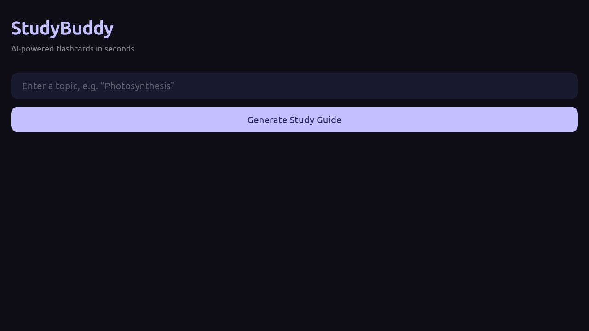
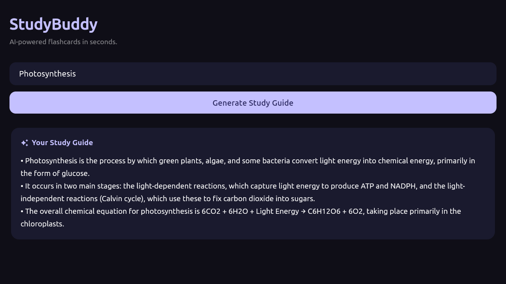

# StudyBuddy

A study assistant that generates concise flashcards for any topic. The Flutter client sends the topic to a Node.js Express backend, which calls the Google Gemini API (`gemini-2.5-flash`) and returns three structured flashcards.

## Screenshots

| Generate | Results |
|:---:|:---:|
|  |  |

## Features

- Generates three structured, factual flashcards for a given topic.
- The Gemini API key stays on the backend and is never shipped inside the app.
- The Flutter client selects the correct backend address for web, desktop and the Android emulator.
- Dark theme with responsive layouts.

## Architecture

```
Flutter app  ->  Express backend (Node.js)  ->  Gemini API
   (UI)            holds API key, builds prompt     (gemini-2.5-flash)
```

## Tech stack

- **Frontend:** Flutter (Dart)
- **Backend:** Node.js, Express
- **AI:** Google Gemini API through the official `@google/genai` SDK

## Getting started

### Prerequisites
- Flutter SDK
- Node.js
- A Gemini API key from [Google AI Studio](https://aistudio.google.com/)

### Backend
```bash
cd backend
npm install
export GEMINI_API_KEY="your-api-key-here"
npm start
```
The backend runs on `http://localhost:3000`.

### Frontend
```bash
cd flutter_app
flutter pub get
flutter run
```

## Roadmap

- [ ] Choose the number of flashcards
- [ ] Save and revisit decks
- [ ] Validate and rate-limit incoming requests on the backend
